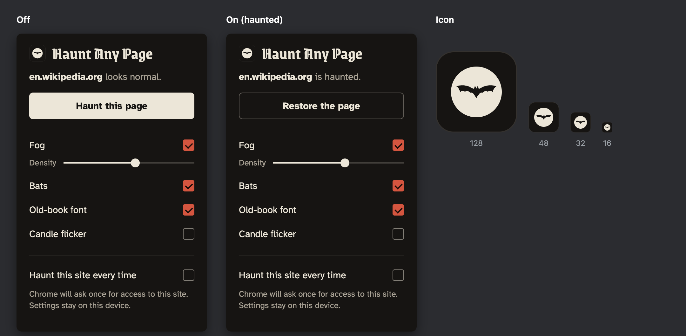

# Haunt Any Page

A browser extension for Chrome that transforms any website into a haunted version of itself with a single click. Perfect for the spooky season!



## Features

- 🌫️ **Drifting fog layers** — Procedurally generated noise clouds with realistic movement
- 🦇 **Flying bats** — Physics-based flight simulation with erratic darting behavior
- 📜 **Old-book font** — Vintage typography for that ancient manuscript feel
- 🕯️ **Candle flicker** — Subtle lighting effects at the edges
- 🌙 **Dark mode aware** — Automatically detects and adjusts for already-dark pages
- 💾 **Remember per site** — Optional persistent haunting for your favorite sites
- ♿ **Respects motion preferences** — Static effects for users who prefer reduced motion

## Installation

### Load Unpacked (Development)

1. Clone this repository or download and extract the ZIP
2. Open Chrome and navigate to `chrome://extensions/`
3. Enable "Developer mode" (toggle in top right)
4. Click "Load unpacked"
5. Select the `HauntAnyPage` folder
6. Click the extension icon in your toolbar to haunt the current page!

### From Chrome Web Store

_Coming soon for the Kiroween 2026 hackathon!_

## How to Use

1. Navigate to any website (http or https)
2. Click the extension icon to open the popup
3. Click "Haunt this page" to apply the effect
4. Adjust fog density, toggle bats, font, and flicker as desired
5. Check "Haunt this site every time" to remember your settings (Chrome will ask for permission once)
6. Click "Restore the page" to return to normal

### Unsupported Pages

The extension cannot run on:
- Chrome internal pages (`chrome://`, `chrome-extension://`)
- Chrome Web Store pages
- New tab page
- Local files (unless you grant file access in extension settings)

## Permissions Explained

### Install-time permissions

- **activeTab** — Access the current tab when you click the extension icon
- **scripting** — Inject the haunt effect into pages
- **storage** — Remember your settings locally (never synced)

### Optional permissions

- **Site access** (requested per-site) — Only when you check "Haunt this site every time"
  - Chrome will show a permission dialog
  - You can revoke this at any time from the extension popup or Chrome settings
  - Settings are stored locally and never leave your device

## Privacy

This extension:
- ✅ Stores settings only in local browser storage (not synced)
- ✅ Uses bundled fonts (no CDN requests)
- ✅ Never makes network requests
- ✅ Never collects or transmits any data
- ✅ Works entirely offline after installation

All validation is enforced by automated checks in `scripts/check-privacy.mjs`.

## Manual Test Checklist

Before release, test on these real sites:

- [ ] **Wikipedia** (https://en.wikipedia.org) — Light page with articles
- [ ] **GitHub** (https://github.com, dark mode) — Already dark page
- [ ] **YouTube** (https://youtube.com) — Complex layouts, strict CSP
- [ ] **BBC News** (https://bbc.com/news) — News site with images
- [ ] **Hacker News** (https://news.ycombinator.com) — Minimal design
- [ ] **Discord** (https://discord.com) — Already dark, modern app
- [ ] **MDN** (https://developer.mozilla.org, dark mode) — Documentation

### What to verify:

- Skin applies without breaking layout
- Fog renders and drifts smoothly
- Bats spawn, fly erratically, and spread across viewport
- Font applies to text but not icons or code blocks
- "Restore" returns page to original state (outerHTML matches)
- No errors in DevTools console
- No network requests from the extension in DevTools Network tab

## Development

### Prerequisites

- Node.js 20+ (for tests and validation scripts)
- Chrome or Chrome for Testing

### Scripts

```bash
npm test              # Run unit tests
npm run test:e2e      # Run end-to-end test (requires GUI)
npm run check         # Run privacy, manifest, and contrast checks
```

### Project Structure

```
manifest.json
src/
  shared/settings.js     # Settings defaults and storage helpers
  popup/                 # Extension popup UI
  content/               # Content script (injected into pages)
  background.js          # Service worker (syncs remembered sites)
assets/
  fonts/                 # Bundled OFL fonts
  icons/                 # Extension icons (16, 32, 48, 128px)
tests/                   # Unit tests and e2e smoke test
scripts/                 # Validation scripts (privacy, manifest, contrast)
```

### Tech Stack

- **Manifest V3** — Modern Chrome extension format
- **Plain ES modules** — No build step, no bundler, no frameworks
- **Web APIs** — Canvas (fog), Web Animations (bats), FontFace API (fonts)
- **Testing** — Node.js built-in test runner + Puppeteer for e2e

## Design Philosophy

This extension follows strict "no AI slop" design rules:
- No glows, no gradients, no centered layouts
- Flat colors, left-aligned, minimal decoration
- Two typefaces with distinct roles
- Plain, specific copy (no "spells" or "curses")
- Transitions only where needed (120-200ms)

See `docs/kiro-usage.md` for details on how Kiro specs, steering files, and hooks were used during development.

## License

MIT License — see [LICENSE](LICENSE) file.

Fonts are licensed under the SIL Open Font License (OFL) — see [assets/fonts/OFL.txt](assets/fonts/OFL.txt).

## Credits

- **Fonts**:
  - IM Fell DW Pica by Igino Marini
  - Grenze Gotisch by Omnibus-Type
  - Atkinson Hyperlegible by Braille Institute
- **Concept art**: See `concept/` directory
- **Built with**: Kiro IDE during Kiroween 2026 hackathon

## Contributing

This is a hackathon project and not actively maintained beyond the initial release. Feel free to fork and modify for your own use!

---

Made with 🦇 for Kiroween 2026
